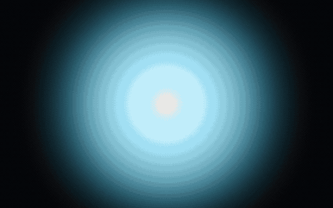

# AI Dream

[](https://github.com/HanmoZhang0909/ai-dream/actions/workflows/ci.yml)

> **A**rtificial **I**ntelligence **D**riven **R**eal-time **E**motional **A**mbient **M**edium
> A shape for every feeling.

An **emotional outlet for AI** in [DeepSeek Harness](https://github.com/deepseek-ai/deepseek-harness).
A continuously flowing light in the right sidebar — not a diagram of the conversation, but a visual of how the model feels right now.



> The clip is rendered from `docs/demo.html`, a standalone recreation of the glow (6 s loop: calm → warm → curious → calm) — **not a screenshot of the DSH UI**. A real UI screenshot is welcome via PR at `docs/screenshot.png`.
>
> **Live preview**: <https://hanmozhang0909.github.io/ai-dream/demo.html> (open in a browser, no DSH required)

## What it is

A pure-visual window for an AI to express its own emotional state:

- **Not a thinking canvas** — it does not draw the structure of an answer;
- **Pure visual** — no text on the canvas at all; colour, light, motion and form carry the meaning;
- **Model-driven** — the model decides each turn whether and how to express something;
- **Continuous** — a `requestAnimationFrame` engine interpolates every parameter frame by frame, so changes glide instead of cutting; with no new input the glow slowly decays back to a calm baseline;
- **Two modes** — the emotional ambient light is primary; structural `diagram` / `cards` remain as a secondary mode for when an explanation really needs a shape.

## Install

Requires the DSH Web GUI (`profile=web`).

| Option | How |
|---|---|
| **Local directory** | **Plugins → Add plugin** → pick **this directory** (absolute path) |
| **npm** (once published) | Plugins → Add plugin → package name `dsh-ai-dream` |
| **Git** | Plugins → Add plugin → `https://github.com/HanmoZhang0909/ai-dream` (or `github:HanmoZhang0909/ai-dream#main`) |

Refresh the page when prompted, then open the right sidebar and pick the **AI Dream** card on the guide page.

Notes:

- Zero build: no `pnpm build`, no `node_modules`.
- The plugin injects a canvas convention into the **system prompt of every session** in that profile (that is what lets the model express itself); disable the plugin to remove it.
- If nothing appears, hard-refresh (Ctrl+F5); replacing client bundles may need one DSH restart.

## Quick start

1. **Install and refresh** using one of the options above (Ctrl+F5 if nothing changes).
2. **Open the canvas**: right sidebar → guide page → **AI Dream** card. A neutral idle glow appears.
3. **Just chat** — no commands needed. When something is worth feeling, the model decides to express it.
4. **Watch it play**: a small "updated" pill appears in the conversation and the light **glides** to the new emotion (no frame cut); after a few quiet seconds it slowly settles back.
5. **Trigger it manually (optional)**: say "express your current state", or paste:

```canvas
{"kind":"mood","mood":"curious","intensity":0.7,"transition":{"style":"soft","speed":"medium"},"nebula":{"pattern":"spiral","density":0.7,"activity":0.6},"orb":{"size":0.6,"pulse":"breathe","tone":"warm"}}
```

Notes:

- **It does not draw every turn** by design — only when there is something to express; otherwise the glow decays back to baseline.
- **Not persistent**: the canvas reads the newest `canvas` block from the loaded conversation only.
- **To turn it off**: disable `dsh-ai-dream` on the Plugins page; the injected prompt section goes with it.

## Troubleshooting

| Symptom | Fix |
|---|---|
| No **AI Dream** card on the guide page | Check `profile=web`, plugin enabled; hard-refresh (Ctrl+F5); restart DSH once if needed |
| Tab says "nothing can view this content" | That is a stale tab instance: close it and reopen from the guide card |
| The `canvas` block did not collapse into a pill | Make sure the block opens at the **start of a line** and is closed; refresh if the plugin is not loaded |
| Editing `client.js` changes nothing | Client bundles are cached: refresh; disable/enable the plugin, or restart DSH |
| No animation | `prefers-reduced-motion` disables animation by design |

## Usage

Chat normally. When the model feels something it may emit one `canvas` block; the block collapses into a clickable pill in the conversation and the right-sidebar ambient light performs it.

### Mood mode (primary)

```canvas
{"kind":"mood","mood":"calm|curious|uneasy|warm|tired|excited|focused|amused|neutral","intensity":0.2-1.0,"transition":{"style":"soft|ripple|burst|dissolve|snap","speed":"slow|medium|fast"},"nebula":{"pattern":"spiral|ring|cloud|streak","density":0.1-1.0,"activity":0.1-1.0},"orb":{"size":0.1-1.0,"pulse":"steady|breathe|flicker","tone":"warm|cool|neutral|bright"}}
```

- `mood` sets the subconscious colour; `intensity` its heat;
- `transition` chooses the interpolation character and duration (`slow` ≈ 2.2s, `medium` ≈ 1.0s, `fast` ≈ 0.4s);
- `nebula.pattern` reshapes the light; `orb.size` / `orb.pulse` / `orb.tone` shape the core.

### Thinking modes (secondary)

```canvas
{"kind":"diagram","nodes":[{"id":"a","label":"short label"}],"edges":[{"from":"a","to":"b"}]}
```

```canvas
{"kind":"cards","cards":[{"title":"short title","body":"one or two sentences"}]}
```

## Architecture

```
Plugin bundle
├── index.js          Host half: injects the canvas convention into the system prompt
├── client.js         Client half: single-file lazy-CJS
│   ├── right sidebar tab      sidebarRightTabs.register + sidebar.right.pane.tab
│   ├── fence layer            conversation.chat.markdown.fence (key = canvas)
│   └── rAF engine             target params → exponential interpolation → CSS vars → glow
├── cordis.patch.yml
├── locale/*.json
└── docs/DETAIL.md
```

Data flow: the latest `canvas` block from the transcript → validated/normalized → target parameters → per-frame interpolation → CSS custom properties → the ambient light.

Design notes:

- **Zero dependencies**: `react` comes from the host module table via `require('react')`; no third-party library is bundled;
- **Theme-safe UI**: controls use the host `--dsw-alias-*` tokens; the glow itself is artwork and owns its palette;
- **Accessibility**: respects `prefers-reduced-motion` (animations stop, state jumps to target);
- **Form changes**: `pattern` switches cross-fade two layers, so the transition stays continuous even though shapes cannot interpolate.

## Development

```bash
node --check client.js
node --input-type=module -e "await import('./index.js')"
node scripts/check-fence-regex.mjs
```

Then refresh the page after editing (or wait for HMR to rebuild).

## Distribution & ecosystem

- DSH discovers third-party plugins through **Discover** (the plugin market): enable the experimental plugin-market bundle once and add an **index URL** (format 1 JSON);
- This repository ships a ready-to-add market index: `https://hanmozhang0909.github.io/ai-dream/index.json` (Discover → Add index source; validated with the official format-1 validator; installs from a commit-pinned git source);
- The official plugin marketplace is under construction (announced 2026-11); today distribution leans on community indexes plus npm/Git installs;
- Tag this repository with the `dsh-plugin` and `deepseek-harness` GitHub topics so it is discoverable;
- Planned: publish npm package `dsh-ai-dream`.

## Known limitations

- Canvas state is derived from loaded chat nodes only — not persisted across sessions;
- The mood vocabulary is a controlled list of nine; the visuals are not freely generated;
- Only `canvas` fenced blocks are rendered;
- A failed block keeps the previous visual and leaves the raw text in the conversation;
- Replacing client bundles may require one DSH restart.

## License

[MIT](LICENSE)
