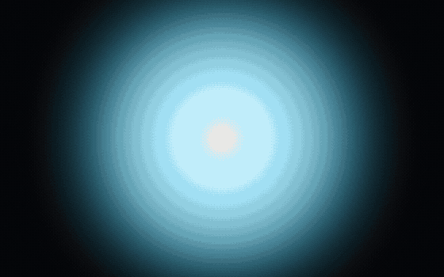

# AI Dream

[](https://github.com/HanmoZhang0909/ai-dream/actions/workflows/ci.yml)

> **A**rtificial **I**ntelligence **D**riven **R**eal-time **E**motional **A**mbient **M**edium
> 让每个 AI 的感受有形状。
> *A shape for every feeling.*

给 [DeepSeek Harness](https://github.com/deepseek-ai/deepseek-harness) 的 **AI 情感出口**：
右侧栏一块连续流动的光——不是解释对话，而是表达 AI 自己的情绪状态。



> 上图为 `docs/demo.html` 独立复刻页渲染的 6 秒循环（calm → warm → curious → calm），**不是 DSH 界面截图**；真实界面截图欢迎 PR 补到 `docs/screenshot.png`。想交互看效果，直接浏览器打开 `docs/demo.html`。

## 它是什么

给 AI 一个纯视觉的表达窗口：

- **不是思维画布**：不画答案的结构，画的是"我此刻是什么状态"；
- **纯视觉**：画布上没有任何文字，颜色、亮度、运动、形态承担表达；
- **AI 自主**：每一轮由模型自己决定要不要表达、表达什么，不逼迫、不每轮必画；
- **连续演化**：由 `requestAnimationFrame` 逐帧插值，新状态不会"跳帧"，而是滑过去；长时间没有新表达会自然衰减回基线；
- **可选的双模式**：主模式是情绪氛围光，次模式保留结构化的 `diagram` / `cards`，用于确实需要解释结构的场合。

## 安装

前提：正在使用 DSH 的 Web 界面（`profile=web`）。

| 方式 | 操作 |
|---|---|
| **本地目录** | 打开 **插件** 页 → **Add plugin** → 选**本仓库目录**（绝对路径） |
| **npm**（发布后） | 插件页 → Add plugin → 输入包名 `dsh-ai-dream` |
| **Git** | 插件页 → Add plugin → 输入 `https://github.com/HanmoZhang0909/ai-dream`（或 `github:HanmoZhang0909/ai-dream#main`） |

安装完成后按提示刷新页面，然后打开右侧栏，在起始页点「**AI Dream**」卡片。

> 也可以让 Agent 用 `plugin_manager` 的 `install_bundle`，`target` 传本目录的绝对路径。

注意事项：

- 本插件**零构建**，不需要 `pnpm build`，也不需要 `node_modules`。
- 安装后会在该 profile 的**所有会话**里注入一段画布格式说明（这是 AI 能自主表达的前提）；不需要时禁用插件即可。
- 如果页面没变化，先强制刷新（Ctrl+F5）；插件安装/替换后偶尔需要重启一次 DSH。

## 快速上手

第一次用，跟着这五步：

1. **安装并刷新**：按上面的方式安装插件，按提示刷新页面（不生效就 Ctrl+F5）。
2. **打开画布**：打开右侧栏 → 起始页 → 点「**AI Dream**」卡片。画布会先显示一个中性待机光。
3. **正常聊天**：不用下指令。聊到有情绪的地方，AI 会自己决定表达——例如聊到累、开心、害怕、被安慰。
4. **看它演出**：对话里会出现一行「已更新到 Dream」的折叠提示，右侧的光会**滑向**新的情绪（不是跳变），停下几秒后会慢慢暗下来。
5. **主动触发（可选）**：直接说「表达一下你现在的状态」，或者把下面这段贴进对话：

```canvas
{"kind":"mood","mood":"curious","intensity":0.7,"transition":{"style":"soft","speed":"medium"},"nebula":{"pattern":"spiral","density":0.7,"activity":0.6},"orb":{"size":0.6,"pulse":"breathe","tone":"warm"}}
```

几个要知道的点：

- **不是每轮都画**：这是设计——只在真的"有感受"时表达；没有新表达时光会自然衰减回基线。
- **画布不持久**：它只从当前会话已加载的对话里取最新 `canvas` 块，换会话/刷新会重新开始。
- **想让它停下来**：在插件页禁用 `dsh-ai-dream` 即可，注入的提示词也会一起移除。

## 常见问题

| 现象 | 处理 |
|---|---|
| 起始页没有「AI Dream」卡片 | 确认 profile 是 `web`、插件已启用；强制刷新（Ctrl+F5）；仍不行重启一次 DSH |
| 画布 tab 显示「这类内容还没有可用的查看方式」 | 那是旧的 tab 实例：关掉该 tab，再从起始页卡片重新打开 |
| 对话里的 canvas 块没折叠成提示 | 确认块以**行首的三个反引号 + canvas** 开头并完整闭合；插件未加载时先刷新页面 |
| 改了 `client.js` 页面没变化 | 客户端 bundle 有缓存：刷新；必要时禁用再启用插件，或重启 DSH |
| 画布没有动画 | 系统开启了「减少动态效果」（prefers-reduced-motion）时会停用动画，属预期行为 |
| 不想让所有会话都带提示词 | 插件页禁用插件；提示词随插件一起移除 |

## 使用

正常聊天即可。AI 有情绪时会自己输出一个 `canvas` 块，对话里它会折叠成一行可点击提示，右侧氛围光同步演出。

### 情绪模式（主）

```canvas
{"kind":"mood","mood":"calm|curious|uneasy|warm|tired|excited|focused|amused|neutral","intensity":0.2-1.0,"transition":{"style":"soft|ripple|burst|dissolve|snap","speed":"slow|medium|fast"},"nebula":{"pattern":"spiral|ring|cloud|streak","density":0.1-1.0,"activity":0.1-1.0},"orb":{"size":0.1-1.0,"pulse":"steady|breathe|flicker","tone":"warm|cool|neutral|bright"}}
```

| 字段 | 含义 |
|---|---|
| `mood` | 下意识情绪，决定背景光的主色与色温 |
| `intensity` | 情绪强度：影响亮度、大小与呼吸速度 |
| `transition.style` | 插值性格：`soft` 常规、`dissolve` 更慢更柔、`burst` 更快并带一次亮度闪、`ripple` 附带扩散环、`snap` 立即到位 |
| `transition.speed` | 插值时长：`slow` ≈ 2.2s、`medium` ≈ 1.0s、`fast` ≈ 0.4s |
| `nebula.pattern` | 光的形态：`cloud` 柔圆光晕、`ring` 光环、`streak` 光带、`spiral` 缓慢旋转 |
| `orb.size` | 光球大小 |
| `orb.pulse` | 呼吸方式：`steady` / `breathe` / `flicker` |
| `orb.tone` | 光球色温：`warm` / `cool` / `neutral` / `bright` |

九种情绪：`neutral` 中性待机、`calm` 平静、`curious` 好奇、`uneasy` 不安、`warm` 温暖、`tired` 疲惫、`excited` 兴奋、`focused` 专注、`amused` 轻快。

### 思维模式（次）

```canvas
{"kind":"diagram","nodes":[{"id":"a","label":"短标签"}],"edges":[{"from":"a","to":"b"}]}
```

```canvas
{"kind":"cards","cards":[{"title":"短标题","body":"一两句话"}]}
```

## 架构

```
Plugin bundle
├── index.js          Host 半边：向系统提示注入画布约定（何时表达 + JSON schema）
├── client.js         Client 半边：单文件 lazy-CJS
│   ├── 右栏 tab        sidebarRightTabs.register + sidebar.right.pane.tab
│   ├── fence 折叠层    conversation.chat.markdown.fence（key = canvas）
│   └── rAF 引擎        目标参数 → 逐帧指数插值 → CSS 自定义属性 → 氛围光
├── cordis.patch.yml  bundle patch
├── locale/*.json     插件行标题/描述
└── docs/DETAIL.md    插件详情页
```

数据流：

```
对话消息里的 canvas 块
  → useChat 选择器取最新一块 → JSON 校验/归一化
  → 目标参数（颜色 / 尺寸 / 透明度 / 模糊 / 形态）
  → rAF 每帧指数插值（τ 由 transition 决定）
  → 写入 CSS 自定义属性 → 氛围光连续演化
```

技术要点：

- **零依赖**：`react` 从宿主模块表 `require('react')` 取得，不打包任何第三方库；
- **主题安全**：UI 元素只用宿主 `--dsw-alias-*` token；氛围光本身属于 artwork，使用自有色板；
- **可访问性**：尊重 `prefers-reduced-motion`，开启后停止动画、直接到目标状态；
- **形态切换**：`pattern` 变化用双层交叉淡化，形状不插值但过渡连续。

## 开发

```bash
# 语法检查（无需安装依赖）
node --check client.js
node --input-type=module -e "await import('./index.js')"

# fence 提取器回归测试（防止行内 ```canvas 被误识别）
node scripts/check-fence-regex.mjs

# 重新生成 README 演示动图（需要 Chrome + ffmpeg）
powershell -File scripts/render-demo-gif.ps1

# 本地安装后：改 client.js → 刷新页面（或等 HMR 轮询重建）
```

仓库结构：

```
.
├── index.js              Host 半边（系统提示）
├── client.js             Client 半边（氛围光全部渲染逻辑）
├── cordis.patch.yml
├── package.json
├── locale/{en,zh}.json
├── docs/
│   ├── DETAIL.md         插件管理器详情页
│   ├── demo.html         独立复刻页（浏览器直接打开即可交互预览）
│   ├── demo.gif          README 演示动图
│   └── design-notes.md   设计背景与开源方案调研
├── scripts/
│   ├── check-fence-regex.mjs   fence 提取器回归测试
│   └── render-demo-gif.ps1     重新生成 README 动图
└── icon.svg
```

## 分发与生态

- DSH 的第三方插件通过 **Discover（插件市场）** 被发现：启用实验性插件市场 bundle 后，添加一个**索引 URL**（format 1 JSON）即可浏览与安装；
- 本仓库自带一个可直接添加的市场索引：`https://raw.githubusercontent.com/HanmoZhang0909/ai-dream/main/index.json`（Discover → Add index source；已用官方校验器验证，安装规格为 commit 固定的 git 源）；
- 官方插件市场正在建设中（2026-11 官方披露），目前生态主要靠各索引与 npm/Git 安装；
- 本仓库建议在 GitHub 上打 `dsh-plugin`、`deepseek-harness` topics，方便按主题检索；
- 后续计划：发布 npm 包 `dsh-ai-dream`。

## 已知限制

- 画布状态来自当前已加载的对话节点，**不跨会话、不持久化**；
- 情绪是受控词表（9 种），不是自由生成画面；
- 只渲染 `canvas` 语言的 fence；
- 画布数据解析失败时保留上一版成功结果，原文保留在对话中；
- 插件安装/替换 UI 代码后，偶尔需要重启 DSH 才能载入新 bundle。

## License

[MIT](LICENSE)
